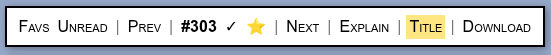

# XKCD Toolbar

Unofficial Chrome toolbar for xkcd.com: browse with your keyboard, jump to any comic, toggle the hover text, open Explain XKCD, download the image with a clean filename, and keep track of which comics you have read and which are your favorites. No build step, no dependencies.



Panel layout:

```text
Favs  Unread | Prev | #353 ✓ ⭐ | Next | Explain | Title | Download
```

Favs and Unread switch the navigation mode (they change where Prev / Next lead), the ✓ and ⭐ next to the comic number are its read and favorite state. Favs, Unread, ✓ and ⭐ appear once your stored lists have loaded.

## Features

- Automatically runs on XKCD comic pages
- Previous / Next navigation, with the neighbouring comics prefetched in the background so flipping through them feels instant
- Toggle the comic's hover text (the image's title attribute) below the image
- Pin the hover text so it is shown automatically on every comic (Shift+T); the Title button is highlighted while pinned and the choice is remembered, and synced across your Chrome profile
- Open the Explain XKCD page
- Download the comic image with format `xkcd-NUMBER-COMIC-NAME.EXT`
- Jump to any comic number (click the comic number in the panel, or press G)

### Read tracking and favorites

- Opening a comic records it as read. The panel shows 👀 on the first visit and ✓ on later ones
- Click the icon (or press U) to mark the comic as unread (✗): it is removed from your history and shows 👀 again the next time you open it. Click again to mark it as read
- Favorites: ☆ / ⭐ next to the comic number, toggled by clicking or pressing F
- Navigation modes: Shift+F makes the arrow keys (and Prev / Next) jump between your favorites, Shift+U between unread comics. The Favs / Unread buttons at the start of the panel show which mode is on. The mode is per tab; press Esc or the same shortcut to leave it
- Import your reading history with Shift+I (see below)

Both lists are stored with `chrome.storage.sync`, so they follow your Chrome
profile, and several open tabs keep each other's changes instead of overwriting
them.

### Keyboard shortcuts

- Left Arrow: previous comic
- Right Arrow: next comic
- Home: first comic
- End: latest comic
- T: Toggle comic title
- Shift+T: Pin / unpin the comic title (always show it)
- E: Explain XKCD
- D: Download comic
- G: Go to comic number
- F: Add / remove favorite
- U: Mark as unread / read
- Shift+F: Favorites navigation mode (arrows jump between favorites)
- Shift+U: Unread navigation mode (arrows jump between unread comics)
- Shift+I: Import read comics
- Esc: Leave the navigation mode (or close the import dialog)

### Importing your reading history

Press Shift+I and enter the comics you have already read, one range per line,
both ends included (`a-b`, `a..b` or a single number):

```text
1-117
160..190
```

Importing replaces the whole read history: every comic outside the ranges
becomes unread. Favorites are not touched.

## Permissions and data

- `downloads`: save the comic image with a clean filename
- `storage`: remember the pinned hover text, your read history and your favorites (`chrome.storage.sync`)
- The extension only runs on `xkcd.com` and `www.xkcd.com`. Besides the page itself it requests neighbouring comic pages (to prefetch their images) and `/info.0.json` (to know the latest comic number in unread mode) from the same site. Nothing is sent anywhere else

## Install

1. Clone this repository (or download it as a ZIP from GitHub and extract it):

   ```sh
   git clone https://github.com/andrezgz/chrome-xkcd-toolbar.git
   ```

2. Open `chrome://extensions` in Chrome.
3. Enable **Developer mode** (top-right toggle).
4. Click **Load unpacked**.
5. Select the cloned folder (the one containing `manifest.json`).
6. Visit any comic on [xkcd.com](https://xkcd.com) and the toolbar will appear.

No build step or dependencies are required. After pulling changes, click the
reload icon on the extension's card in `chrome://extensions`.

## Development

```sh
npm install
npm run lint
npm test
```

The extension icons in `icons/` are PNG renders of `icons/icon.svg`. To
regenerate them after editing the SVG (requires ImageMagick):

```sh
for s in 16 48 128; do
  convert -background none -density $((s*3)) icons/icon.svg -resize ${s}x${s} -depth 8 icons/icon$s.png
done
```

## Disclaimer

This is an unofficial extension and is not affiliated with, endorsed by, or
sponsored by xkcd or Randall Munroe. xkcd comics are licensed by their author
under [CC BY-NC 2.5](https://xkcd.com/license.html).

## License

[MIT](LICENSE)
